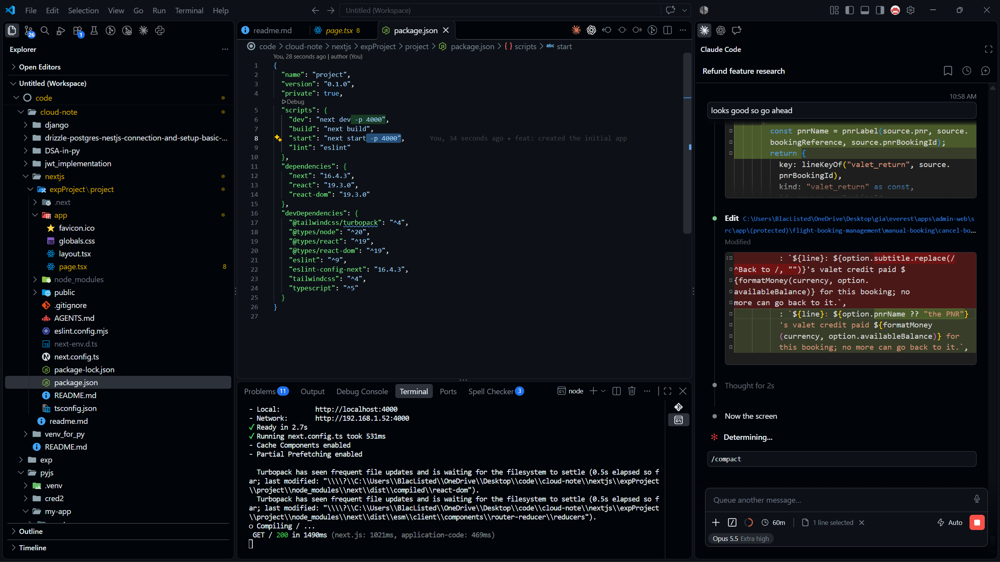
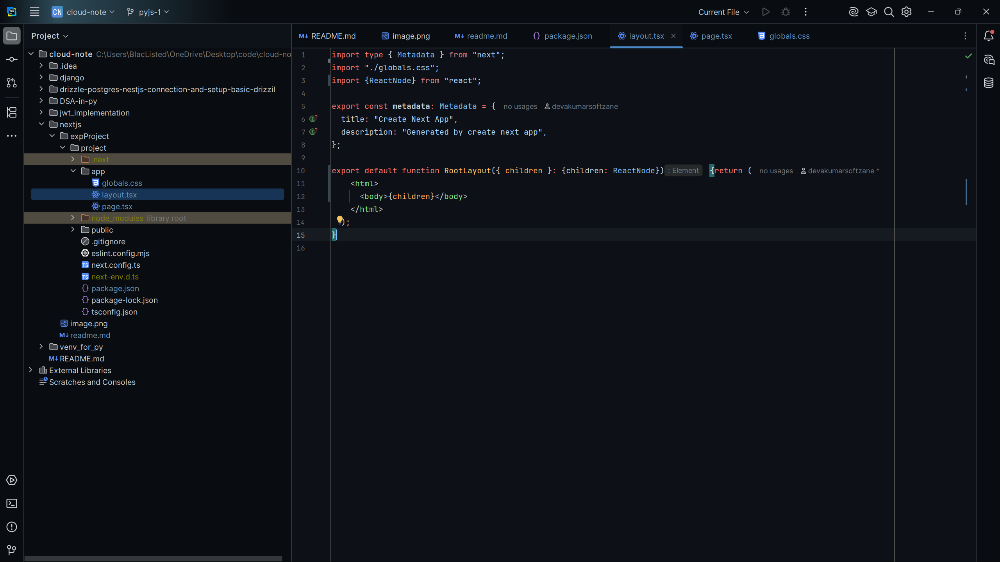
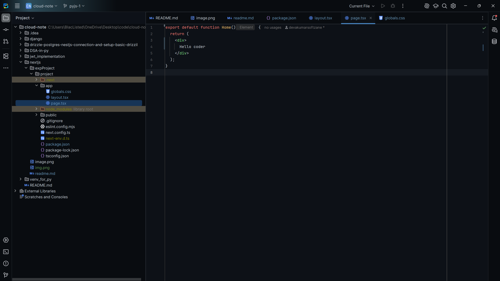
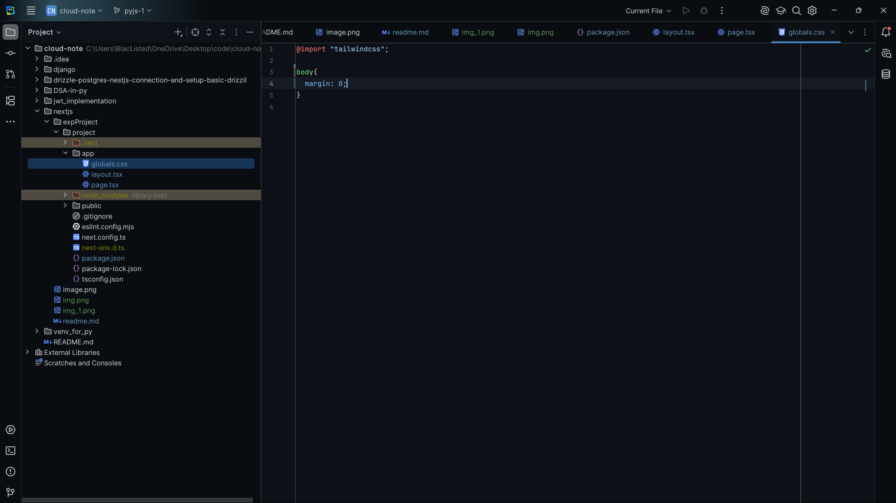
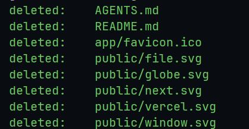

# Next.js

## Creation and configuring Nextjs application
```
npx create-next-app@latest my-app --yes
cd my-app
npm run dev
```

- **--yes**  skips prompts using saved preferences or defaults. The default setup enables TypeScript, Tailwind CSS, ESLint, App Router, and Turbopack, with import alias @/*, and includes AGENTS.md to guide coding agents to write up-to-date Next.js code.

- when running the project by default it will run in the port 3000 if we need to change it we need to use
  ' -p 4000' in heat 4000 is the new port address the implementation is shown in the given image
  

## Now let's clean up the default Next.js boilerplate and keep only what we need
we are going to edit the 'app/global.css', 'app/layout.tsx', 'app/page.tsx', and remove every image in the 'public'
folder as given bellow







**we are completely removing the given files**



## Understanding the `app` folder

A cleaned-up Next.js project may look like this:

```text
project/
├── app/
│   ├── globals.css
│   ├── layout.tsx
│   └── page.tsx
├── public/
├── package.json
└── next.config.ts
```

The `app` folder is one of the most important parts of Next.js. It uses **file-system-based routing**.

**In simple terms:** The folders and special files you create determine which URLs exist in your application.

Unlike a React application using React Router, you do not have to manually configure every route. Next.js uses the directory structure to define routes.

---

## What is `page.tsx`?

A `page.tsx` file defines the UI shown at a particular URL.

**File: `app/page.tsx`**

```tsx
export default function Home() {
  return (
    <div>
      <h1>Welcome to Next.js</h1>
    </div>
  );
}
```

Open:

```text
http://localhost:3000
```

Next.js finds `app/page.tsx` and renders its default-exported component.

```text
app/page.tsx  ──────>  http://localhost:3000/
```

**Remember:**

- `page.tsx` is a **special filename** in the App Router.
- `app/page.tsx` is the homepage (`/`).
- An ordinary component file such as `Home.tsx` does **not** automatically create a route.
- A route becomes a navigable page when its segment has a `page.tsx` file.

---

## Creating another page

Let's create an **About** page.

Inside the `app` directory, create an `about` folder with a `page.tsx` file:

```text
app/
├── layout.tsx
├── page.tsx
└── about/
    └── page.tsx
```

**File: `app/about/page.tsx`**

```tsx
export default function About() {
  return (
    <div>
      <h1>About Page</h1>
      <p>This is my first additional route.</p>
    </div>
  );
}
```

Now visit:

```text
http://localhost:3000/about
```

You should see:

```text
About Page
This is my first additional route.
```

### How does Next.js create the URL?

Each regular folder within `app` represents a **route segment**. A `page.tsx` file inside that folder defines the page shown at its URL.

| File | URL |
| --- | --- |
| `app/page.tsx` | `/` |
| `app/about/page.tsx` | `/about` |
| `app/contact/page.tsx` | `/contact` |
| `app/dashboard/page.tsx` | `/dashboard` |
| `app/dashboard/settings/page.tsx` | `/dashboard/settings` |

**Important:** Creating the `about` folder alone does not make `/about` a page. To visit `/about` as a page, define `app/about/page.tsx`.

---

## What is `layout.tsx`?

Imagine an application with five pages. You want the same navigation bar and footer on every page.

Without shared layouts, you might copy the header and footer into every page. Next.js avoids that repetition with **layouts**.

A `layout.tsx` file defines shared UI that wraps pages (and nested layouts) beneath it.

**File: `app/layout.tsx`**

```tsx
import type { ReactNode } from "react";
import "./globals.css";

export default function RootLayout({
  children,
}: {
  children: ReactNode;
}) {
  return (
    <html lang="en">
      <body>
        <header>
          <h1>My Website</h1>
        </header>

        {children}

        <footer>
          <p>Copyright 2026</p>
        </footer>
      </body>
    </html>
  );
}
```

The root layout wraps the app's pages. The header and footer appear around whichever page is currently being shown.

**Note:** In the App Router, the root layout must contain `<html>` and `<body>`.

### What is `children`?

`children` is a standard React prop. It represents the content placed inside a component.

**Example in React:**

```tsx
import type { ReactNode } from "react";

function Container({ children }: { children: ReactNode }) {
  return <div>{children}</div>;
}
```

When you use:

```tsx
<Container>
  <h1>Hello</h1>
</Container>
```

The `<h1>Hello</h1>` element becomes `Container`'s `children`.

**In Next.js:** When someone visits `/about`, the About page is rendered in the root layout's `{children}` position.

```text
RootLayout
┌──────────────────────────────────┐
│ Header: My Website               │
│                                  │
│ {children}                       │
│   ┌──────────────────────────┐   │
│   │ About Page               │   │
│   │ This is my first ...     │   │
│   └──────────────────────────┘   │
│                                  │
│ Footer: Copyright 2026           │
└──────────────────────────────────┘
```

Shared layouts are preserved during client-side navigation between pages using the same layout, helping retain layout state rather than remounting the layout each time.

---

## Nested layouts

Suppose you are building an admin dashboard. You want a sidebar on all dashboard pages, but not on public pages.

Create a layout specifically for the `dashboard` folder:

```text
app/
├── layout.tsx                  # Root layout
├── page.tsx                    # /
└── dashboard/
    ├── layout.tsx              # Shared dashboard layout
    ├── page.tsx                # /dashboard
    └── settings/
        └── page.tsx            # /dashboard/settings
```

**File: `app/dashboard/layout.tsx`**

```tsx
import type { ReactNode } from "react";

export default function DashboardLayout({
  children,
}: {
  children: ReactNode;
}) {
  return (
    <div>
      <aside>Dashboard Sidebar</aside>
      <main>{children}</main>
    </div>
  );
}
```

When someone visits `/dashboard/settings`, Next.js composes these components:

```text
RootLayout
└── DashboardLayout
    └── SettingsPage
```

This means:

- The root layout surrounds the whole application.
- The dashboard layout surrounds dashboard pages only.
- The settings page appears in the dashboard layout's `{children}` position.

**Real-world use:** Different areas of an application can have different shared UI—for example, a public website, staff dashboard, and manager portal.

---

## Route Groups — Organizing routes with `()`

So far, we've learned that normal folders inside `app` usually become parts of the URL. **Route Groups** are an exception.

To create a route group, wrap the folder name in parentheses:

```text
(main)
(auth)
(marketing)
```

**The name inside `()` does NOT appear in the URL.** This lets us organize related pages and give different sections their own layouts without changing their public URLs.

### 1. Route groups do not change URLs

Consider this structure:

```text
app/
├── layout.tsx
├── (main)/
│   ├── page.tsx
│   ├── about/
│   │   └── page.tsx
│   └── contact/
│       └── page.tsx
└── (auth)/
    ├── login/
    │   └── page.tsx
    └── register/
        └── page.tsx
```

| File | URL |
| --- | --- |
| `app/(main)/page.tsx` | `/` |
| `app/(main)/about/page.tsx` | `/about` |
| `app/(main)/contact/page.tsx` | `/contact` |
| `app/(auth)/login/page.tsx` | `/login` |
| `app/(auth)/register/page.tsx` | `/register` |

**Remember:** A route group is for organizing the code. It does not automatically create a page or URL. You still need `page.tsx` to render a page.

### 2. Using route groups to show different headers and footers

Suppose you want:

- The **Home** and **Blog** pages to show a *Main Header* and *Main Footer*.
- The **About** and **Company** pages to show an *About Header* and *About Footer*.
- All pages to share the same document-level root layout.

Use the following structure:

```text
app/
├── globals.css
├── layout.tsx                 # Root: html + body only
├── (main)/
│   ├── layout.tsx             # Main Header + Footer
│   ├── page.tsx               # /
│   └── blog/
│       └── page.tsx          # /blog
└── about/
    ├── layout.tsx             # About Header + Footer
    ├── page.tsx               # /about
    └── company/
        └── page.tsx          # /about/company
```

**File: `app/layout.tsx` (shared Root Layout)**

```tsx
import type { ReactNode } from "react";
import "./globals.css";

export default function RootLayout({
  children,
}: {
  children: ReactNode;
}) {
  return (
    <html lang="en">
      <body>{children}</body>
    </html>
  );
}
```

The Root Layout has no visible header or footer, but it still wraps **every** route.

**File: `app/(main)/layout.tsx`**

```tsx
import type { ReactNode } from "react";

export default function MainLayout({
  children,
}: {
  children: ReactNode;
}) {
  return (
    <div>
      <header>Main Header</header>
      <main>{children}</main>
      <footer>Main Footer</footer>
    </div>
  );
}
```

**File: `app/about/layout.tsx`**

```tsx
import type { ReactNode } from "react";

export default function AboutLayout({
  children,
}: {
  children: ReactNode;
}) {
  return (
    <div>
      <header>About Header</header>
      <main>{children}</main>
      <footer>About Footer</footer>
    </div>
  );
}
```

**File: `app/about/company/page.tsx`**

```tsx
export default function Company() {
  return <p>This is the Company page.</p>;
}
```

When visiting `/about/company`, the layout hierarchy is:

```text
RootLayout (app/layout.tsx)
└── AboutLayout (app/about/layout.tsx)
    └── Company Page (app/about/company/page.tsx)
```

**Visible result:**

```text
About Header
This is the Company page.
About Footer
```

The **Main Header** and **Main Footer** are not shown because the About route is **outside** `(main)`. However, the **Root Layout still renders**.

> **Important:** Route groups do not cancel or skip a parent layout. They let us decide which pages share a *group-specific* layout. This approach is usually best when we want one shared Root Layout and different UI for different sections.

### 3. Can we skip the Root Layout completely?

Not if a shared `app/layout.tsx` exists: every page beneath `app` inherits it. But Next.js does support **multiple independent Root Layouts**.

To use this approach, remove the top-level `app/layout.tsx` and give each top-level section its own root layout:

```text
app/
├── globals.css
├── (main)/
│   ├── layout.tsx             # Main Root Layout
│   ├── page.tsx               # /
│   └── blog/
│       └── page.tsx
└── about/
    ├── layout.tsx             # About Root Layout
    ├── page.tsx               # /about
    └── company/
        └── page.tsx          # /about/company
```

Now `app/(main)/layout.tsx` and `app/about/layout.tsx` are **root layouts** for separate sections. **Both** must contain `<html>` and `<body>`.

**Example: `app/about/layout.tsx` as an independent Root Layout**

```tsx
import type { ReactNode } from "react";
import "../globals.css";

export default function AboutRootLayout({
  children,
}: {
  children: ReactNode;
}) {
  return (
    <html lang="en">
      <body>
        <header>About Header</header>
        {children}
        <footer>About Footer</footer>
      </body>
    </html>
  );
}
```

The Main Root Layout must also define `<html>` and `<body>` and should import the shared CSS if needed. The homepage `/` must belong to one of these sections (such as `app/(main)/page.tsx`).

**Tradeoff:** Navigating between pages with different root layouts causes a **full page load**, unlike navigation within one shared root layout.

### 4. Important rules and common mistakes

| Rule | Explanation |
| --- | --- |
| Use `(name)` | Parentheses mark a route group; the group name is omitted from the URL. |
| Don't create duplicate URLs | `app/(main)/about/page.tsx` and `app/(other)/about/page.tsx` both map to `/about` and conflict. |
| Avoid two homepages | Don't keep both `app/page.tsx` and `app/(main)/page.tsx` because both map to `/`. |
| A shared root is still inherited | `app/layout.tsx` wraps pages even if the pages are inside route groups. |
| Root layouts require `<html>` and `<body>` | Nested layouts must not create another `<html>` or `<body>`. |
| Each `layout.tsx` needs a React component | The default export must be a valid component that renders its `children` where appropriate. |
| The URL ignores route groups | To link to `app/(main)/blog/page.tsx`, use `<Link href="/blog">`, not `/main/blog`. |

### Quick comparison

| Setup | Layouts for `/about/company` | Best for |
| --- | --- | --- |
| One shared `app/layout.tsx` | Root Layout → About Layout → Company Page | Most applications; separate section UI without a full reload between roots. |
| Multiple Root Layouts (no `app/layout.tsx`) | About Root Layout → Company Page | Sections needing fully separate document-level layouts. |

**Practice:** Place your homepage in `(main)`, keep the About/Company pages outside that group, and check that `/about/company` shows only the **About Header**, **Company Page**, and **About Footer**—while still using the shared Root Layout.

**Official documentation:** [Next.js Route Groups](https://nextjs.org/docs/app/api-reference/file-conventions/route-groups) and [Next.js Layouts](https://nextjs.org/docs/app/api-reference/file-conventions/layout).

---

## Navigation using `Link`

Next.js provides a `Link` component for navigating between internal pages.

Import it with:

```tsx
import Link from "next/link";
```

**File: `app/page.tsx`**

```tsx
import Link from "next/link";

export default function Home() {
  return (
    <main>
      <h1>Home Page</h1>
      <p>Welcome to my application.</p>

      <Link href="/about">Go to About</Link>
    </main>
  );
}
```

Clicking **Go to About** navigates to `/about`.

### Why use `Link` rather than `<a>` for internal routes?

- `Link` supports optimized **client-side navigation**.
- Next.js can **prefetch** linked routes to make navigation feel faster.
- It works naturally with shared App Router layouts.

A regular `<a>` tag is still useful for external links or when a full-page navigation is intentionally needed.

**Note:** You do **not** need to add `"use client"` just to render a `Link`.

---

## Other important Next.js files

You'll encounter these special filenames as you learn more:

| File | What it does |
| --- | --- |
| `page.tsx` | Defines the page for a URL. |
| `layout.tsx` | Defines UI shared across pages in a route segment. |
| `loading.tsx` | Defines loading UI for a route segment. |
| `error.tsx` | Defines an error boundary UI for a route segment. |
| `not-found.tsx` | Defines a not-found UI. |
| `route.ts` | Defines HTTP request handlers (such as `GET` and `POST`). |
| `template.tsx` | Similar to a layout, but creates a new instance on navigation. |

You don't need to master every file now. We'll learn them one at a time as they become relevant.

---

## Quick revision

| Concept | Remember |
| --- | --- |
| `app/` | Contains routes and shared route UI in the App Router. |
| `page.tsx` | Defines an actual page at a URL. |
| Folders | Usually correspond to URL segments. |
| `layout.tsx` | Wraps pages and nested layouts with shared UI. |
| `children` | The nested page or layout rendered within a layout. |
| Nested layouts | Let sections like `/dashboard` have their own shared UI. |
| Route groups `(name)` | Organize pages and give sections different layouts without adding the group name to URLs. |
| Multiple Root Layouts | Separate root layouts for different sections when there is no shared top-level `app/layout.tsx`. |
| `Link` | Provides optimized internal navigation. |

### Important takeaway

```text
app/page.tsx                        -> /
app/about/page.tsx                  -> /about
app/dashboard/page.tsx              -> /dashboard
app/dashboard/settings/page.tsx     -> /dashboard/settings
```

And layouts compose from outermost to innermost:

```text
app/layout.tsx -> app/dashboard/layout.tsx -> app/dashboard/settings/page.tsx
```

---

## Practice quiz

**1. Which file defines the homepage in an App Router application?**

A. `app/index.tsx`  
B. `app/page.tsx`  
C. `app/home.tsx`

**2. What URL does `app/products/details/page.tsx` create?**

A. `/products`  
B. `/products/details`  
C. `/details/page`

**3. What does the `children` prop represent in a layout?**

A. The current nested page or layout  
B. A database record  
C. The current URL string

### Answers

1. **B** — `app/page.tsx` maps to `/`.
2. **B** — Each folder contributes a URL segment.
3. **A** — The nested page or layout renders inside `{children}`.

---

## Coding exercise

**Task:** Create a Contact page and link to it from the homepage.

1. Create `app/contact/page.tsx`.
2. Add a heading such as `Contact Page`.
3. Import `Link` from `next/link` in `app/page.tsx`.
4. Add a link to `/contact`.
5. Run `npm run dev` and visit `http://localhost:3000/contact`.
6. Leave `app/layout.tsx` unchanged.

**Expected folder structure:**

```text
app/
├── globals.css
├── layout.tsx
├── page.tsx
├── about/
│   └── page.tsx
└── contact/
    └── page.tsx
```

---
# Lesson 3 — Dynamic Routing and `loading.tsx` in Next.js

> **Version:** Next.js 16 (App Router)  
> **Goal:** Understand dynamic URL segments, route parameters, loading states, and how to test them.

---

## 1. What is Dynamic Routing?

In a student management application, every student may have a profile URL:

```text
/students/1
/students/2
/students/3
```

We **do not** need to create separate `page.tsx` files for every student. Instead, we use a **dynamic route**: one page component handles different URL values.

### Folder structure

```text
app/
├── layout.tsx
└── students/
    ├── page.tsx              # /students — list of students
    └── [id]/
        ├── page.tsx          # /students/1, /students/2, etc.
        └── loading.tsx       # Loading UI for this dynamic page
```

The square brackets in `[id]` tell Next.js that this part of the URL is **variable**.

| URL | Route file | Captured value |
| --- | --- | --- |
| `/students/1` | `app/students/[id]/page.tsx` | `id = "1"` |
| `/students/2` | `app/students/[id]/page.tsx` | `id = "2"` |
| `/students/25` | `app/students/[id]/page.tsx` | `id = "25"` |

**Remember:** A folder named `[id]` is a dynamic segment, while a folder named `(main)` is a **route group**. A route group is omitted from the URL; a dynamic segment captures a URL value.

---

## 2. Reading `params` in a Dynamic Page

**File: `app/students/[id]/page.tsx`**

```tsx
export default async function StudentDetails({
  params,
}: {
  params: Promise<{ id: string }>;
}) {
  const { id } = await params;

  return (
    <div>
      <h1>Student Details</h1>
      <p>Student ID: {id}</p>
    </div>
  );
}
```

### How this works

1. Next.js matches `/students/2` to the `[id]` folder.
2. It provides `params`, which contains the captured route values.
3. In Next.js 16, `params` is a **Promise**, so we use `await params`.
4. `const { id } = await params` extracts the student ID.
5. The component renders `Student ID: 2`.

### Understanding the syntax

```tsx
params: Promise<{ id: string }>
```

This tells TypeScript that resolving `params` produces an object with a string field called `id`.

```tsx
const { id } = await params;
```

This is **object destructuring**. It is similar to:

```tsx
const resolvedParams = await params;
const id = resolvedParams.id;
```

**Important notes:**

- Route parameter values are generally **strings**, even when they look numeric (`"2"`, not `2`).
- The name in `[id]` determines the key `id`. `[studentId]` would produce `studentId` instead.
- Pages are Server Components by default. An `async` Server Component can use `await` directly.
- Older Next.js tutorials may show synchronous `params.id`; for Next.js 16, use `await params`.
- A dynamic URL segment does **not** necessarily mean the page must be rendered only at request time; some dynamic paths can also be prerendered.

---

## 3. Multiple Dynamic Parameters

You can use more than one dynamic segment:

```text
app/
└── departments/
    └── [department]/
        └── students/
            └── [id]/
                └── page.tsx
```

This matches `/departments/cse/students/15`.

**File: `app/departments/[department]/students/[id]/page.tsx`**

```tsx
export default async function StudentPage({
  params,
}: {
  params: Promise<{ department: string; id: string }>;
}) {
  const { department, id } = await params;

  return (
    <div>
      <p>Department: {department}</p>
      <p>Student ID: {id}</p>
    </div>
  );
}
```

For `/departments/cse/students/15`, the resolved parameters are:

```ts
{ department: "cse", id: "15" }
```

---

## 4. Linking to Dynamic Pages with `Link`

Rather than typing the URL manually, use `Link` from `next/link`.

**File: `app/students/page.tsx`**

```tsx
import Link from "next/link";

const students = [
  { id: 1, name: "Arun" },
  { id: 2, name: "Rahul" },
  { id: 3, name: "Anu" },
];

export default function Students() {
  return (
    <main>
      <h1>Students</h1>

      {students.map((student) => (
        <p key={student.id}>
          <Link href={`/students/${student.id}`}>
            {student.name}
          </Link>
        </p>
      ))}
    </main>
  );
}
```

The backticks form a **template literal**:

```tsx
`/students/${student.id}`
```

For student ID `2`, the link becomes `/students/2`. `Link` enables optimized internal navigation; Next.js can also prefetch route content.

---

## 5. Handling an Invalid ID with `notFound()`

The `[id]` route also matches `/students/999`. Next.js cannot automatically know whether student `999` exists in your data.

For an example with locally defined students:

```tsx
import { notFound } from "next/navigation";

const students = [
  { id: 1, name: "Arun" },
  { id: 2, name: "Rahul" },
];

export default async function StudentDetails({
  params,
}: {
  params: Promise<{ id: string }>;
}) {
  const { id } = await params;
  const student = students.find((s) => String(s.id) === id);

  if (!student) {
    notFound();
  }

  return <h1>{student.name}</h1>;
}
```

`notFound()` stops rendering that page and shows the applicable not-found UI. Later, we can do the same validation using a database query instead of an array.

---

## 6. What is `loading.tsx`?

A page may need time to fetch data from an API or database. We should display a useful **loading state** while the content is not ready.

Next.js provides the special filename `loading.tsx` for this purpose.

**File: `app/students/[id]/loading.tsx`**

```tsx
export default function Loading() {
  return <h2>Loading student details...</h2>;
}
```

When you navigate to a student page, Next.js can show this loading UI while its page content is rendering. Once the content is ready, Next.js replaces the loading UI with the page.

### What happens behind the scenes?

`loading.tsx` automatically creates a **React Suspense boundary** around the page and nested child content at its segment.

Conceptually:

```text
User clicks /students/2
        |
        v
Student page is not ready
        |
        v
loading.tsx appears (fallback)
        |
        v
Server finishes rendering page.tsx
        |
        v
Student Details — Student ID: 2
```

**Suspense in simple terms:** React can show temporary fallback content while something inside that boundary is waiting. When it finishes, React displays the actual content.

**Remember:** `loading.tsx` belongs to the route folder where you want that loading state to apply. For example, `app/students/loading.tsx` applies to the students segment and routes below it; `app/students/[id]/loading.tsx` provides a more specific boundary around the dynamic student page.

---

## 7. Why Might the Loading Screen Be Too Fast to See?

If your page only reads an ID and displays a heading, it may render so quickly that the fallback is barely visible or never noticeably appears.

For learning, simulate a slow operation using `setTimeout` wrapped in a Promise.

**File: `app/students/[id]/page.tsx`**

```tsx
export default async function StudentDetails({
  params,
}: {
  params: Promise<{ id: string }>;
}) {
  const { id } = await params;

  // Artificial 3-second delay: for learning only.
  await new Promise<void>((resolve) => {
    setTimeout(resolve, 3000);
  });

  return (
    <main>
      <h1>Student Details</h1>
      <p>Student ID: {id}</p>
    </main>
  );
}
```

### How the delay works

```tsx
await new Promise<void>((resolve) => {
  setTimeout(resolve, 3000);
});
```

- `Promise` represents a result that will become available later.
- `setTimeout(resolve, 3000)` schedules `resolve()` after **3,000 milliseconds (3 seconds)**.
- `await` pauses **this async function** until the Promise resolves; it does not freeze the entire server.
- The component then returns its page content.

The artificial delay happens on the **server** because this is a Server Component.

### How to test

1. Run `npm run dev`.
2. Open the student list, for example `http://localhost:4004/students` (use your configured port).
3. Click a student link to navigate to `/students/2`.
4. While the page waits, look for `Loading student details...`.
5. After about 3 seconds, the actual Student Details page should appear.

If you do not notice the fallback, try navigating to a **different student ID**. Route prefetching, caching, and dev-mode behavior can affect what you see.

**Do not add artificial delays in production.** They are only useful for demonstrations or testing.

---

## 8. The Prerendering / Blocking Route Error You Encountered

You previously saw a Next.js development warning like:

```text
Next.js encountered runtime data during prerendering.
```

It pointed to:

```tsx
const { id } = await params;
```

When **Cache Components** and instant-navigation checks are enabled, Next.js expects request-dependent or uncached asynchronous work to be handled with an appropriate Suspense fallback, cached where suitable, or otherwise configured for the intended rendering behavior.

Adding this file resolved the issue in your project:

```text
app/students/[id]/loading.tsx
```

```tsx
export default function Loading() {
  return <p>Loading student details...</p>;
}
```

This solution works by providing a Suspense boundary around the page. It does **not** mean `await params` is incorrect; `await params` is the correct pattern in Next.js 16.

Not every dynamic route in every Next.js configuration needs its own `loading.tsx`. The requirement depends on its rendering and runtime-data behavior.

---

## 9. Dynamic Route Params vs Search Params

Do not confuse these two URL styles:

| Example | Type | Used for |
| --- | --- | --- |
| `/students/2` | Dynamic path parameter | Identifying a student resource |
| `/students?id=2` | Search (query-string) parameter | Filtering or selecting data |

Dynamic path parameters are read using `params`. Search parameters are read using `searchParams` in page components (also a Promise in Next.js 16). We'll study search parameters separately.

---

## 10. Quick Revision Table

| Concept | Meaning |
| --- | --- |
| `[id]` | Captures a value from a URL path segment. |
| `params` | Contains dynamic route values. |
| `Promise<{ id: string }>` | TypeScript type of the asynchronous `params` value. |
| `await params` | Resolves the route parameters. |
| `Link` | Navigates to another route using Next.js. |
| `notFound()` | Displays not-found UI for an invalid resource. |
| `loading.tsx` | Defines fallback UI during route loading. |
| `Suspense` | Allows fallback content while nested content is waiting. |
| `setTimeout` + `Promise` | Simulates a delay for testing. |
| `()` | Route grouping without adding the group name to the URL. |
| `[]` | Dynamic routing with a value captured from the URL. |

### Key ideas to remember

1. **One `[id]/page.tsx` handles many IDs.**
2. **In Next.js 16, `params` is a Promise; await it in Server Components.**
3. **Route values are strings unless you convert and validate them.**
4. **`loading.tsx` provides a Suspense-based loading fallback.**
5. **A simulated delay is only for learning, not production.**

---

## 11. Practice Exercises

**Exercise 1 — Products**

Create `app/products/[id]/page.tsx` and display the product ID for `/products/101`, `/products/102`, and `/products/103` using only one page file.

**Exercise 2 — Loading UI**

Create `app/products/[id]/loading.tsx` showing `Loading product details...`. Add a temporary 2-second delay inside the product page to test it.

**Exercise 3 — Links**

Create `app/products/page.tsx` with links to the three product pages.

**Exercise 4 — Invalid product**

Create a small local products array and use `notFound()` when the requested product ID does not exist.

### Self-check questions

1. What is the difference between `(main)` and `[id]`?
2. Why is `params` typed as `Promise<{ id: string }>` in Next.js 16?
3. Why might a loading screen be invisible on a very fast page?
4. What is the relationship between `loading.tsx` and Suspense?
5. Should we deliberately delay real production pages?

---

# Lesson 4 — Advanced Routing in Next.js

> **Version:** Next.js 16 (App Router)  
> **Prerequisites:** `page.tsx`, `layout.tsx`, route groups `(main)`, dynamic segments `[id]`, and `loading.tsx`.  
> **Goal:** Understand catch-all routes, optional catch-all routes, URL search parameters, and how Server and Client Components read them.

---

## 1. Quick Recap: Normal Dynamic Routes `[id]`

A normal dynamic route captures **exactly one** URL segment.

```text
app/
└── students/
    └── [id]/
        └── page.tsx
```

| URL | Captured parameter |
| --- | --- |
| `/students/10` | `{ id: "10" }` |
| `/students/25` | `{ id: "25" }` |

```tsx
// app/students/[id]/page.tsx
export default async function StudentPage({
  params,
}: {
  params: Promise<{ id: string }>;
}) {
  const { id } = await params;
  return <h1>Student ID: {id}</h1>;
}
```

In Next.js 16, **`params` is a Promise** in a page's props, so use `await params`. Dynamic parameter values from the URL are strings.

**But what if a URL contains more than one varying segment?** That is where catch-all routes are useful.

---

## 2. Catch-All Routes `[...slug]`

A **catch-all route** captures **one or more URL segments** with a single route file.

Imagine a documentation website:

```text
/docs/nextjs
/docs/nextjs/routing
/docs/nextjs/routing/dynamic-routes
```

### Folder structure

```text
app/
└── docs/
    └── [...slug]/
        ├── page.tsx
        └── loading.tsx    # Optional loading UI
```

The three dots (`...`) mean **capture the remaining path segments**.

### Implementation

**File: `app/docs/[...slug]/page.tsx`**

```tsx
export default async function DocsPage({
  params,
}: {
  params: Promise<{ slug: string[] }>;
}) {
  const { slug } = await params;

  return (
    <div>
      <h1>Documentation</h1>
      <p>Segments: {slug.join(" / ")}</p>
    </div>
  );
}
```

### How the captured values look

| URL | `slug` value |
| --- | --- |
| `/docs/nextjs` | `["nextjs"]` |
| `/docs/nextjs/routing` | `["nextjs", "routing"]` |
| `/docs/nextjs/routing/dynamic-routes` | `["nextjs", "routing", "dynamic-routes"]` |

Notice the TypeScript type:

```tsx
params: Promise<{ slug: string[] }>;
```

It is an **array of strings** because more than one segment may be captured.

### What does `join()` do?

```ts
const slug = ["nextjs", "routing", "dynamic-routes"];
console.log(slug.join(" / "));
// nextjs / routing / dynamic-routes
```

`join()` combines the elements of an array into a string, using the supplied separator.

### Important limitation

With a folder named `[...slug]`, `/docs` by itself **does not match** that catch-all page. The route expects **at least one** path segment after `/docs`.

---

## 3. Optional Catch-All Routes `[[...slug]]`

An **optional catch-all route** is similar to `[...slug]`, except it also matches the parent URL with **zero** additional segments.

Replace `[...slug]` with `[[...slug]]`:

```text
app/
└── docs/
    └── [[...slug]]/
        ├── page.tsx
        └── loading.tsx
```

**File: `app/docs/[[...slug]]/page.tsx`**

```tsx
export default async function DocsPage({
  params,
}: {
  params: Promise<{ slug?: string[] }>;
}) {
  const { slug } = await params;

  return (
    <div>
      <h1>Documentation</h1>
      <p>{slug ? slug.join(" / ") : "Documentation Home"}</p>
    </div>
  );
}
```

| URL | `slug` value | Output |
| --- | --- | --- |
| `/docs` | `undefined` | Documentation Home |
| `/docs/nextjs` | `["nextjs"]` | nextjs |
| `/docs/nextjs/routing` | `["nextjs", "routing"]` | nextjs / routing |

### Why `slug?: string[]`?

The `?` means the `slug` property is **optional**. When the URL is exactly `/docs`, there may be no `slug` value.

### Important

Use **either** `[...slug]` **or** `[[...slug]]` for this docs example. Do not keep both folders for the same route pattern, because their matching routes overlap.

---

## 4. Comparing `[id]`, `[...slug]`, and `[[...slug]]`

| Folder name | How many segments? | Example | Parameter type |
| --- | --- | --- | --- |
| `[id]` | Exactly one | `/students/10` | `string` |
| `[...slug]` | One or more | `/docs/a/b` | `string[]` |
| `[[...slug]]` | Zero or more | `/docs`, `/docs/a/b` | `string[] \| undefined` |

**Easy way to remember:**

- `[id]`: I need exactly **one** value.
- `[...slug]`: I need **at least one**, possibly several.
- `[[...slug]]`: I can have **none or several**.

**Real-world examples:** Documentation paths, nested product categories, file browsers, and content hierarchies.

### Related concept: `(main)` is not a dynamic route

Recall from Lesson 2:

```text
app/(main)/page.tsx   -> /
app/students/[id]/page.tsx -> /students/10
```

A folder in parentheses is a **route group**; it does not appear in the URL. A folder in square brackets is a **dynamic segment**; it captures a URL value.

---

## 5. Search Parameters (`searchParams`)

Now consider an e-commerce website where users filter or sort products:

```text
/products?category=electronics&sort=asc
```

Break it down:

- `/products` — the **pathname** (route).
- `?` — starts the **query string**.
- `category=electronics` — a query parameter (key and value).
- `&` — separates query parameters.
- `sort=asc` — another query parameter.

**Unlike a dynamic path segment, query parameters do not require folders named after their keys.**

### Step 1 — Create a page

```text
app/
└── products/
    ├── page.tsx
    └── loading.tsx
```

**File: `app/products/page.tsx`**

```tsx
export default async function ProductsPage({
  searchParams,
}: {
  searchParams: Promise<{
    category?: string;
    sort?: string;
  }>;
}) {
  const { category = "all", sort = "asc" } =
    await searchParams;

  return (
    <div>
      <h1>Products</h1>
      <p>Category: {category}</p>
      <p>Sort: {sort}</p>
    </div>
  );
}
```

**File: `app/products/loading.tsx`**

```tsx
export default function Loading() {
  return <p>Loading products...</p>;
}
```

### Test these URLs

| URL | Category output | Sort output |
| --- | --- | --- |
| `/products` | all | asc |
| `/products?category=electronics` | electronics | asc |
| `/products?category=clothing&sort=desc` | clothing | desc |

### Understanding the default values

```tsx
const { category = "all", sort = "asc" } =
  await searchParams;
```

This resolves the Promise, extracts both properties, and supplies defaults if a property is `undefined`.

**Note:** In Next.js 16, the page's `searchParams` prop is a **Promise**, just like `params`.

### TypeScript detail: repeated query keys

A URL may repeat a key:

```text
/products?category=books&category=games
```

In that case, the raw value can be an array. A more general TypeScript shape is:

```tsx
searchParams: Promise<{
  [key: string]: string | string[] | undefined;
}>;
```

Our simpler example assumes one value per key. For real applications, **validate and normalize** search parameters before relying on them.

---

## 6. Difference Between `params` and `searchParams`

| Feature | `params` | `searchParams` |
| --- | --- | --- |
| Where is the value? | In the URL path | In the query string after `?` |
| Example | `/products/10` | `/products?sort=asc` |
| Folder pattern | `[id]` | No query-specific folder needed |
| Common purpose | Identify a resource | Filtering, sorting, searching |
| Server page access (Next.js 16) | `await params` | `await searchParams` |

### Using both in the same page

URL:

```text
/products/10?color=red
```

**File: `app/products/[id]/page.tsx`**

```tsx
export default async function ProductDetails({
  params,
  searchParams,
}: {
  params: Promise<{ id: string }>;
  searchParams: Promise<{ color?: string }>;
}) {
  const { id } = await params;
  const { color = "default" } = await searchParams;

  return (
    <div>
      <h1>Product: {id}</h1>
      <p>Selected Color: {color}</p>
    </div>
  );
}
```

The **path** identifies product `10`; the **query string** supplies the selected color `red`.

---

## 7. `useSearchParams()` in Client Components

We've used the `searchParams` prop in **Server Component pages**. What if we need the current query string inside a **Client Component**?

Next.js provides a hook:

```tsx
import { useSearchParams } from "next/navigation";
```

### Example: Search viewer

**File: `app/search/SearchViewer.tsx`**

```tsx
"use client";

import { useSearchParams } from "next/navigation";

export default function SearchViewer() {
  const searchParams = useSearchParams();
  const query = searchParams.get("q");

  return (
    <div>
      <h1>Search</h1>
      <p>Searching for: {query ?? "Nothing"}</p>
    </div>
  );
}
```

**File: `app/search/page.tsx`**

```tsx
import { Suspense } from "react";
import SearchViewer from "./SearchViewer";

export default function SearchPage() {
  return (
    <Suspense fallback={<p>Loading search...</p>}>
      <SearchViewer />
    </Suspense>
  );
}
```

Open:

```text
http://localhost:4004/search?q=nextjs
```

Expected output:

```text
Search
Searching for: nextjs
```

### Why `"use client"`?

`useSearchParams()` is a **Client Component hook**. It reads the query string and can update as navigation changes it.

### Why `<Suspense>`?

A Client Component calling `useSearchParams()` can suspend while a static route is prerendered. The Suspense boundary gives Next.js a fallback and keeps the surrounding page eligible for static rendering. This is especially important for production builds of statically rendered routes.

### `searchParams` versus `useSearchParams()`

| | `searchParams` page prop | `useSearchParams()` hook |
| --- | --- | --- |
| Where? | Page Server Component | Client Component |
| How? | `await searchParams` | `useSearchParams().get("q")` |
| Needs `"use client"`? | No | Yes |
| Useful for | Server-side filtering/data fetching | Reactive client-side query display |

---

## 8. What About `loading.tsx` and Suspense?

From Lesson 3, you already know that a route can provide automatic loading UI with `loading.tsx`.

```text
app/docs/[...slug]/
├── page.tsx
└── loading.tsx
```

```tsx
// app/docs/[...slug]/loading.tsx
export default function Loading() {
  return <p>Loading documentation...</p>;
}
```

`loading.tsx` creates a loading boundary for that route segment. This can be useful when the page awaits route parameters or slow server-side data.

By comparison, a manual `<Suspense>` boundary in `app/search/page.tsx` wraps **a specific component**, such as `SearchViewer`.

**Remember:** These are related ideas, but not identical placements of the loading boundary.

---

## 9. Common Mistakes

1. **Using `string` for catch-all `slug`:** `[...slug]` produces `string[]`, not `string`.
2. **Expecting `[...slug]` to match `/docs`:** Use `[[...slug]]` when the empty path should match.
3. **Keeping conflicting catch-all patterns:** Do not define overlapping catch-all and optional catch-all routes for the same URLs.
4. **Confusing `(main)` with `[id]`:** Parentheses are for organizational route groups; square brackets capture dynamic values.
5. **Reading Next.js 16 page props synchronously:** Use `await params` and `await searchParams` in async Server Component pages.
6. **Assuming query parameters are always a string:** A repeated query key can produce `string[]`.
7. **Using `useSearchParams()` in a Server Component:** It is a Client Component hook; put it in a file with `"use client"` and wrap it in Suspense when appropriate.
8. **Assuming a URL query changes the folder route:** `/products?sort=asc` still uses `app/products/page.tsx`.

---

## 10. Quick Revision

| Concept | Remember |
| --- | --- |
| `[id]` | One URL segment (`string`) |
| `[...slug]` | One or more URL segments (`string[]`) |
| `[[...slug]]` | Zero or more URL segments (`string[]` or `undefined`) |
| `params` | Dynamic **path** values, provided asynchronously in Next.js 16 |
| `searchParams` | **Query-string** values, provided asynchronously in Next.js 16 |
| `useSearchParams()` | Client Component hook for reading query values |
| `loading.tsx` | Automatic route-segment loading UI |
| `<Suspense>` | Fallback boundary around asynchronous/suspending content |
| `(name)` | Route group — does not appear in the URL |

---

## 11. Coding Exercise — Product Category Browser

Create this structure:

```text
app/
└── shop/
    └── [[...category]]/
        └── page.tsx
```

**Requirements:**

1. `/shop` shows `All Products`.
2. `/shop/electronics` shows the `electronics` category.
3. `/shop/electronics/mobile` shows both category segments.
4. `/shop/electronics/mobile?sort=asc` also displays the sort parameter.
5. Use `await params` and `await searchParams` as in the examples above.

### Self-check questions

1. Why does `[...slug]` return an array rather than a string?
2. What changes when you add another pair of square brackets: `[[...slug]]`?
3. Where do query parameters appear in a URL?
4. How is `params` different from `searchParams`?
5. Why does `useSearchParams()` require a Client Component?
6. What purpose does a Suspense boundary serve in the search example?

---

# Next.js — Lesson 5: Server Components vs. Client Components

> **Level:** Beginner to Intermediate  
> **Project:** Next.js 16 (App Router)  
> **Prerequisites:** Pages, layouts, dynamic routing, `loading.tsx`, and `searchParams`

## What you'll learn

1. What Server Components and Client Components are.
2. Why Server Components are the default in the App Router.
3. When and why to use `"use client"`.
4. How React state and event handlers work in Client Components.
5. How Server and Client Components work together.
6. How to pass data from the server to a client component.
7. What hydration means.
8. Common mistakes and best practices.

---

## 5.1 — What are Server Components and Client Components?

Next.js has two important types of React components:

- **Server Components:** Render on the server. They're useful for accessing server-side data, fetching from databases, and producing non-interactive UI without sending that component's JavaScript to the browser.
- **Client Components:** Support interactive behavior such as clicks, component state (`useState`), effects (`useEffect`), and browser APIs.

**In Next.js App Router, components are Server Components by default.**

```text
                         NEXT.JS SERVER
                  ┌────────────────────────┐
                  │ Server Components      │
                  │ - Fetch data           │
                  │ - Query the database   │
                  │ - Render page content  │
                  └───────────┬────────────┘
                              │
                 HTML + React Server Component data
                              │
                              ▼
                           BROWSER
                  ┌────────────────────────┐
                  │ Displays the page      │
                  │                        │
                  │ Client Components:     │
                  │ - onClick              │
                  │ - useState             │
                  │ - useEffect            │
                  └────────────────────────┘
```

> **Important:** A Client Component can still be *prerendered* to HTML on the server during the initial request. `"use client"` means the component participates in the client-side React application; it doesn't mean the component is only ever rendered in a browser.

---

## 5.2 — Understanding Server Components

This is a Server Component because there is no `"use client"` directive:

**File:** `app/page.tsx`

```tsx
export default function Home() {
  return (
    <div>
      <h1>Welcome to Next.js</h1>
      <p>This is my homepage.</p>
    </div>
  );
}
```

### Example: Render student data

**File:** `app/students/page.tsx`

```tsx
const students = [
  { id: 1, name: "Arun" },
  { id: 2, name: "Rahul" },
  { id: 3, name: "Anu" },
];

export default function StudentsPage() {
  return (
    <main>
      <h1>Students</h1>

      {students.map((student) => (
        <p key={student.id}>{student.name}</p>
      ))}
    </main>
  );
}
```

In a future database lesson, this could be replaced with a server-side PostgreSQL query using Drizzle ORM:

```tsx
// Illustration only; assumes db and studentsTable are configured.
const students = await db.select().from(studentsTable);
```

### Why use Server Components?

- They can query a database and call server-side services directly.
- They can access private server environment variables; never render secrets into the page or send them as props.
- Their component code isn't shipped as client-side JavaScript.
- They're well suited to product listings, dashboards, reports, and other data-driven pages.

### What can't you do directly in a Server Component?

You cannot directly use browser-side interactive hooks or event handlers, such as:

```tsx
useState(0);                 // Not supported directly in a Server Component
useEffect(() => {}, []);     // Not supported directly in a Server Component
<button onClick={...}>       // Interactive handlers require a Client Component
```

For those, create a Client Component.

---

## 5.3 — Understanding Client Components

Imagine a counter with **Increment** and **Decrement** buttons. Because the UI updates in response to clicks, we need `useState` and an event handler.

**File:** `app/components/Counter.tsx`

```tsx
"use client";

import { useState } from "react";

export default function Counter() {
  const [count, setCount] = useState(0);

  return (
    <div>
      <h1>Counter: {count}</h1>

      <button onClick={() => setCount(count + 1)}>
        Increment
      </button>

      <button onClick={() => setCount(count - 1)}>
        Decrement
      </button>
    </div>
  );
}
```

### Understand the code

**1. `"use client"`**

```tsx
"use client";
```

- Put this directive at the **top of the file, before imports**.
- It marks a boundary where the imported component and its module dependencies are part of the client-side module graph.
- You don't need to repeat it in every component imported from an existing client boundary.

**2. `useState`**

```tsx
const [count, setCount] = useState(0);
```

- `count`: Current state value.
- `setCount`: Function used to update the value.
- `0`: Initial state value.

**3. `onClick`**

```tsx
<button onClick={() => setCount(count + 1)}>
  Increment
</button>
```

When clicked, React updates the component's state and rerenders it **without a full page reload**.

### What happens if you remove `"use client"`?

If this component is treated as a Server Component, Next.js reports an error because `useState` needs a Client Component. Restore `"use client"` to enable its interactive functionality.

---

## 5.4 — Server vs. Client Components: Comparison

| Feature | Server Component | Client Component |
|---|---|---|
| Render JSX | Yes | Yes |
| Fetch data | Yes | Yes |
| Query database directly | Yes | No; use a server endpoint/function |
| Access server-only secrets | Yes, with care | No |
| `useState` | No | Yes |
| `useEffect` | No | Yes |
| Browser event handlers (`onClick`, `onChange`) | No | Yes |
| Browser APIs (`localStorage`, `window`) | No | Yes, after running in browser |
| `async` component function | Yes | Generally not supported |
| Requires `"use client"` | No | Yes, at the client boundary |

> **Note:** Client Components may be prerendered on the server. Code that accesses `window` or `localStorage` should run in browser-only effects/event handlers or be guarded appropriately.

---

## 5.5 — Can a Server Component render a Client Component?

**Yes. This is one of the most common Next.js patterns.** Keep the overall page on the server and make only the interactive parts Client Components.

**File structure:**

```text
app/
├── page.tsx
└── components/
    └── Counter.tsx
```

**File:** `app/page.tsx` (Server Component)

```tsx
import Counter from "./components/Counter";

export default function Home() {
  return (
    <main>
      <h1>Welcome to Next.js</h1>
      <p>This content is rendered on the server.</p>
      <Counter />
    </main>
  );
}
```

**File:** `app/components/Counter.tsx` (Client Component)

```tsx
"use client";

import { useState } from "react";

export default function Counter() {
  const [count, setCount] = useState(0);

  return (
    <button onClick={() => setCount((previous) => previous + 1)}>
      Count: {count}
    </button>
  );
}
```

**Rendering relationship:**

```text
Home (Server Component)
├── <h1>Welcome to Next.js</h1>
├── <p>This content is rendered on the server.</p>
└── Counter (Client Component)
    └── Interactive button with useState
```

### Important boundary rule

- A **Server Component can import and render a Client Component**.
- When a file has `"use client"`, its imports are included in the client module graph, so don't import server-only database modules into that file.
- Advanced pattern: You can pass server-rendered content as `children` or other React element props into a Client Component rather than importing server-only code directly inside it.

---

## 5.6 — Passing data from Server to Client Components

We often fetch data on the server, then pass individual data values to interactive Client Components through **props**.

### Step 1 — Create a Client Component

**File:** `app/students/StudentCard.tsx`

```tsx
"use client";

import { useState } from "react";

type StudentCardProps = {
  id: number;
  name: string;
};

export default function StudentCard({
  id,
  name,
}: StudentCardProps) {
  const [selected, setSelected] = useState(false);

  return (
    <div>
      <h2>{name}</h2>
      <p>Student ID: {id}</p>

      <button onClick={() => setSelected(!selected)}>
        {selected ? "Selected" : "Select"}
      </button>
    </div>
  );
}
```

Here:

- `id` and `name` are received as **props**.
- `selected` is local Client Component **state**.
- Clicking the button updates the local state; it does not modify server data.

### Step 2 — Pass data from a Server Component

**File:** `app/students/page.tsx`

```tsx
import StudentCard from "./StudentCard";

const students = [
  { id: 1, name: "Arun" },
  { id: 2, name: "Rahul" },
  { id: 3, name: "Anu" },
];

export default function StudentsPage() {
  return (
    <main>
      <h1>Students List</h1>

      {students.map((student) => (
        <StudentCard
          key={student.id}
          id={student.id}
          name={student.name}
        />
      ))}
    </main>
  );
}
```

**Flow of data:**

```text
StudentsPage (Server Component)
       │
       │ Provides id and name props
       ▼
StudentCard (Client Component)
       │
       ├── Displays student information
       └── Uses useState for the Select button
```

### Rules for passing props

- Props crossing from Server to Client Components must be **serializable by React**.
- Simple strings, numbers, arrays, and plain data objects are typical choices.
- An ordinary JavaScript callback such as `onClick={() => ...}` cannot be passed directly from a Server Component to a Client Component across this boundary. Server Functions are a special case we'll cover later.
- State maintained with `useState` is temporary and resets on a fresh page load unless you persist it separately.

---

## 5.7 — What is hydration?

When a page initially loads, Next.js can send HTML to the browser so content appears quickly. But plain HTML doesn't know how to execute React click handlers.

**Hydration** is the process where React attaches interactive behavior to the prerendered Client Component markup in the browser.

```text
1. Server prepares the initial HTML
                 │
                 ▼
2. Browser displays the HTML
                 │
                 ▼
3. Client JavaScript loads
                 │
                 ▼
4. React hydrates Client Components
                 │
                 ▼
5. Buttons, state, and interactions work
```

### Why this matters

- Users can see content before all client JavaScript finishes loading.
- Client Components gain React-powered interactivity during hydration.
- Server Components themselves do **not** hydrate like Client Components because their component JavaScript isn't sent to the browser.

---

## 5.8 — Common mistakes

### Mistake 1: Adding `"use client"` everywhere

**Better:** Use Server Components by default. Add a Client Component only for interactive or browser-dependent parts.

### Mistake 2: Calling `useState` inside a Server Component

**Better:** Move that stateful logic to a Client Component.

### Mistake 3: Importing database code in a Client Component

**Better:** Query the database on the server, then pass safe data as props, or call a server endpoint/function.

### Mistake 4: Assuming `"use client"` means browser-only rendering

**Better:** Remember that Client Components can also have HTML prerendered on the server. Browser-only APIs must be used carefully.

### Mistake 5: Adding `"use server"` to every Server Component

**Better:** Don't do this. **Server Components are the default.** `"use server"` is for Server Functions (which we'll study when learning forms and mutations).

---

## 5.9 — Quick revision

| Concept | Remember |
|---|---|
| Server Component | Default component type in App Router |
| Client Component | Supports interactive React and browser-side behavior |
| `"use client"` | Creates a client module boundary |
| `useState` | Stores local state in a Client Component |
| `useEffect` | Handles effects in a Client Component |
| Props | Pass data between components |
| Hydration | Adds React interactivity to prerendered Client Components |
| `"use server"` | Marks Server Functions; not required for Server Components |

### Simple decision rule

```text
Does the component need browser events, state, effects, or browser APIs?
  ├── Yes → Use a Client Component ("use client")
  └── No  → Prefer a Server Component (default)
```

---

## 5.10 — Practice quiz

**1. What is the default component type in the App Router?**

A. Client Component  
B. Server Component  
C. Both automatically

**2. Which feature requires a Client Component?**

A. Rendering a heading  
B. Using `useState` for a counter  
C. Querying a database directly

**3. Can a Server Component render a Client Component?**

A. Yes  
B. No  
C. Only inside `layout.tsx`

**4. What does hydration do?**

A. Queries PostgreSQL  
B. Makes prerendered Client Components interactive  
C. Creates URL routes

**Answers:** 1-B, 2-B, 3-A, 4-B.

---

## 5.11 — Coding exercise

Build the student selection example yourself:

1. Create `app/students/StudentCard.tsx` and add `"use client"`.
2. Add `useState` to track whether a student has been selected.
3. Create `app/students/page.tsx` as a Server Component.
4. Pass each student's `id` and `name` as props to `StudentCard`.
5. Confirm clicking **Select** changes only that student's card without refreshing the page.
6. **Extra challenge:** Add a Reset button that sets `selected` back to `false`.

### Expected folder structure

```text
app/
└── students/
    ├── page.tsx         # Server Component
    └── StudentCard.tsx  # Client Component
```

---

