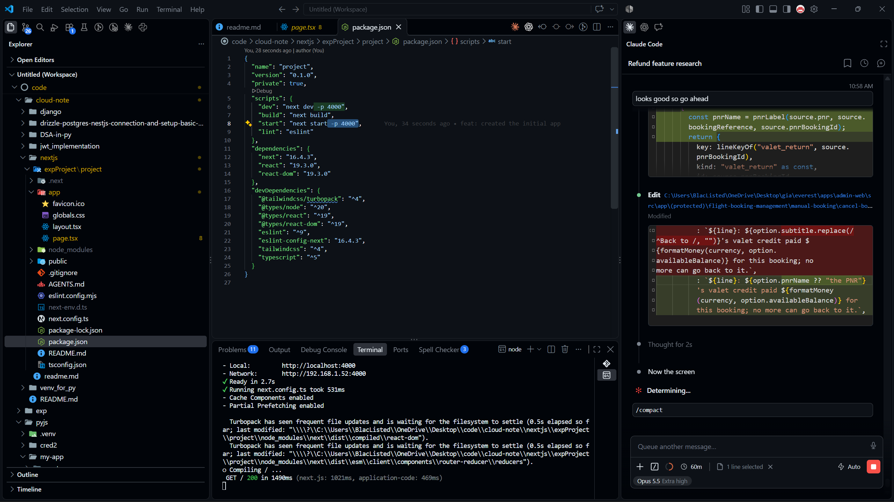

# Next.js

### Creation and configuring Nextjs application
```
npx create-next-app@latest my-app --yes
cd my-app
npm run dev
```

- **--yes**  skips prompts using saved preferences or defaults. The default setup enables TypeScript, Tailwind CSS, ESLint, App Router, and Turbopack, with import alias @/*, and includes AGENTS.md to guide coding agents to write up-to-date Next.js code.

- when running the project by default it will run in the port 3000 if we need to change it we need to use
' -p 4000' in heat 4000 is the new port address the implementation is shown in the given image
